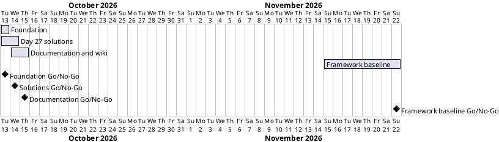

# Project Plan: 027-sandbox

## Metadata
| Key | Value |
| --- | --- |
| ID | PP-001 |
| CrossReference | [BC-001], [SA-001], [MIL-001], [MIL-002], [MIL-003], [MIL-004] |
| Language | en |
| Domain | education |

## Version History
| Date | Status | Author | Reviewer | Change | Commit |
| --- | --- | --- | --- | --- | --- |
| 2026-10-13 | Deprecated | Jens Tirsvad Nielsen | S01 | Initial version | [2124708] |
| 2026-11-15 | Accepted | Jens Tirsvad Nielsen | AI as stand-in for S01 | Added the baseline gateway MIL-004, its schedule row, scope coverage, dependency, risk and Gantt entries, the No-Go rule and an open issue; gave the planning assumptions their source; linked the git host milestones of MIL-001 to MIL-003; set the domain to education; reviewed in autonomous mode, not independent | [2df3c30] |

---

## Purpose

This plan schedules three phases that deliver the Day 27 assignment repository
within the Business Case constraint of about one working day of effort. A fourth gateway, [MIL-004], was added on 2026-11-15 to bring the finished project to the baseline of the framework; it runs from 2026-11-15 to 2026-11-22.

## Planning Assumptions

- Work starts 2026-10-13; the first three gateways end by 2026-10-15 and the baseline gateway [MIL-004] ends by 2026-11-22 (source: [BC-001], Cost–Benefit Assessment and Assumptions).
- Each phase is one pull request from its own branch, closing its issues (source: [BC-001], Constraints).
- Phase 0 (this baseline: Business Case, Stakeholder Analysis, plan, milestones) lands in its own pull request first (a decision of S01, the Product Owner).
- The baseline gateway [MIL-004] starts 2026-11-15 and ends by 2026-11-22, one week (source: [BC-001], Assumptions). It is the only gateway outside the short windows of the first three, because of the agreed minimum quality baseline of the framework.
- For [MIL-004] S01 has authorised the assistant to commit, push, open the pull request and merge it, and the review is done by an AI stand-in for S01 (source: [BC-001], Constraints; [SA-001], Conflicting Interests and Mitigations).

## Gateway Schedule

| Gateway | Document | Window | Decision date | Owner | Stories | Main deliverable | Milestone |
| --- | --- | --- | --- | --- | --- | --- | --- |
| Foundation | [MIL-001] | 2026-10-13 | 2026-10-13 | S01 | none | Skeleton, CI, metadata | [Milestone 138][MS-138] |
| Day 27 solutions | [MIL-002] | 2026-10-13 to 2026-10-14 | 2026-10-14 | S01 | none | Source and tests | [Milestone 139][MS-139] |
| Documentation and wiki | [MIL-003] | 2026-10-14 to 2026-10-15 | 2026-10-15 | S01 | none | README, screenshots, wiki | [Milestone 140][MS-140] |
| Framework baseline | [MIL-004] | 2026-11-15 to 2026-11-22 | 2026-11-22 | S01 | none | The framework release, the wiki in the framework's shape, the licence metadata, the traceability matrix and the review records | [Milestone 539][MS-539] |



## Scope Coverage

| Business Case scope item | Gateway |
| --- | --- |
| `src/` package, `constants.py`, Tkinter apps | MIL-002 |
| `tests/`, `pyproject.toml`, `.gitignore`, `Doxyfile`, CI, repository metadata | MIL-001 |
| README, screenshots, wiki in three languages | MIL-003 |
| Local `.venv` instructions | MIL-003 |
| The baseline: framework release, wiki shape, licence metadata, traceability matrix, review records | MIL-004 |

## Dependencies

```
MIL-001 → MIL-002 → MIL-003 → MIL-004
```

A No-Go moves every later date by the time needed to fix it. A No-Go on [MIL-004] leaves the program and the earlier gateways as they are; S01 decides the new date.

## Plan Risks

| Risk | Impact | Mitigation |
| --- | --- | --- |
| Tkinter missing or no display for screenshots | MIL-003 screenshots blocked | Capture on this Windows desktop; report if impossible |
| Wiki repository not enabled on the host | Wiki task blocked | Report to S01; deliver wiki markdown under `docs/wiki/` as fallback |
| A continuous integration (CI) check fails on the pull request of [MIL-004] | The merge is delayed past 2026-11-22 | The failure is fixed on the same branch and the checks run again; after three failed rounds on one cause the work stops and S01 decides (trace: success criterion 8 of [BC-001]) |

## Open Issues

- The prompt names `https://git.tirsystem.com/Tirsvad-Udemy-100_days_of_code`, while `origin` is `Tirsvad-Udemy-100-days-of-code/027-sandbox`. The plan treats `origin` as the repository that receives description and topics.
- Framework baseline (closed in [MIL-004]): the wiki pages already were in `docs/wiki/`; the baseline gave them the language line first, a sidebar in the framework's shape and a Project Documents page. Every document with a `Domain` row now has the domain `education`.

---

[BC-001]: ./business-case.md
[SA-001]: ./stakeholder-analysis.md
[MIL-001]: ./milestones/mil-001-foundation.md
[MIL-002]: ./milestones/mil-002-day27-solutions.md
[MIL-003]: ./milestones/mil-003-docs-wiki.md
[2124708]: https://git.tirsystem.com/Tirsvad-Udemy-100-days-of-code/027-sandbox/commit/2124708c4b82960e3cc16134c177d420936098be
[MIL-004]: ./milestones/mil-004-framework-baseline.md
[MS-138]: https://git.tirsystem.com/Tirsvad-Udemy-100-days-of-code/027-sandbox/milestone/138
[MS-139]: https://git.tirsystem.com/Tirsvad-Udemy-100-days-of-code/027-sandbox/milestone/139
[MS-140]: https://git.tirsystem.com/Tirsvad-Udemy-100-days-of-code/027-sandbox/milestone/140
[MS-539]: https://git.tirsystem.com/Tirsvad-Udemy-100-days-of-code/027-sandbox/milestone/539
[2df3c30]: https://git.tirsystem.com/Tirsvad-Udemy-100-days-of-code/027-sandbox/commit/2df3c30d60a0fcd26c0fa95a53b13f16905fdc9e
