# Project Plan: 027-sandbox

## Metadata
| Key | Value |
| --- | --- |
| ID | PP-001 |
| CrossReference | [BC-001], [SA-001], [MIL-001], [MIL-002], [MIL-003] |
| Language | en |
| Domain | it |

## Version History
| Date | Status | Author | Reviewer | Change | Commit |
| --- | --- | --- | --- | --- | --- |
| 2026-10-13 | Accepted | Jens Tirsvad Nielsen | S01 | Initial version | [2124708] |

---

## Purpose

This plan schedules three phases that deliver the Day 27 assignment repository
within the Business Case constraint of about one working day of effort.

## Planning Assumptions

- Work starts 2026-10-13 and ends by 2026-10-15.
- Each phase is one pull request from its own branch, closing its issues.
- Phase 0 (this baseline: Business Case, Stakeholder Analysis, plan, milestones) lands in its own pull request first.

## Gateway Schedule

| Gateway | Document | Window | Decision date | Owner | Stories | Main deliverable | Milestone |
| --- | --- | --- | --- | --- | --- | --- | --- |
| Foundation | [MIL-001] | 2026-10-13 | 2026-10-13 | S01 | none | Skeleton, CI, metadata | |
| Day 27 solutions | [MIL-002] | 2026-10-13 to 2026-10-14 | 2026-10-14 | S01 | none | Source and tests | |
| Documentation and wiki | [MIL-003] | 2026-10-14 to 2026-10-15 | 2026-10-15 | S01 | none | README, screenshots, wiki | |

```plantuml
@startgantt
Project starts 2026-10-13
[Foundation] starts 2026-10-13 and ends 2026-10-13
[Day 27 solutions] starts 2026-10-13 and ends 2026-10-14
[Documentation and wiki] starts 2026-10-14 and ends 2026-10-15
[Foundation Go/No-Go] happens 2026-10-13
[Solutions Go/No-Go] happens 2026-10-14
[Documentation Go/No-Go] happens 2026-10-15
@endgantt
```



## Scope Coverage

| Business Case scope item | Gateway |
| --- | --- |
| `src/` package, `constants.py`, Tkinter apps | MIL-002 |
| `tests/`, `pyproject.toml`, `.gitignore`, `Doxyfile`, CI, repository metadata | MIL-001 |
| README, screenshots, wiki in three languages | MIL-003 |
| Local `.venv` instructions | MIL-003 |

## Dependencies

```
MIL-001 → MIL-002 → MIL-003
```

A No-Go moves every later date by the time needed to fix it.

## Plan Risks

| Risk | Impact | Mitigation |
| --- | --- | --- |
| Tkinter missing or no display for screenshots | MIL-003 screenshots blocked | Capture on this Windows desktop; report if impossible |
| Wiki repository not enabled on the host | Wiki task blocked | Report to S01; deliver wiki markdown under `docs/wiki/` as fallback |

## Open Issues

- The prompt names `https://git.tirsystem.com/Tirsvad-Udemy-100_days_of_code`, while `origin` is `Tirsvad-Udemy-100-days-of-code/027-sandbox`. The plan treats `origin` as the repository that receives description and topics.

---

[BC-001]: ./business-case.md
[SA-001]: ./stakeholder-analysis.md
[MIL-001]: ./milestones/mil-001-foundation.md
[MIL-002]: ./milestones/mil-002-day27-solutions.md
[MIL-003]: ./milestones/mil-003-docs-wiki.md
[2124708]: https://git.tirsystem.com/Tirsvad-Udemy-100-days-of-code/027-sandbox/commit/2124708c4b82960e3cc16134c177d420936098be
